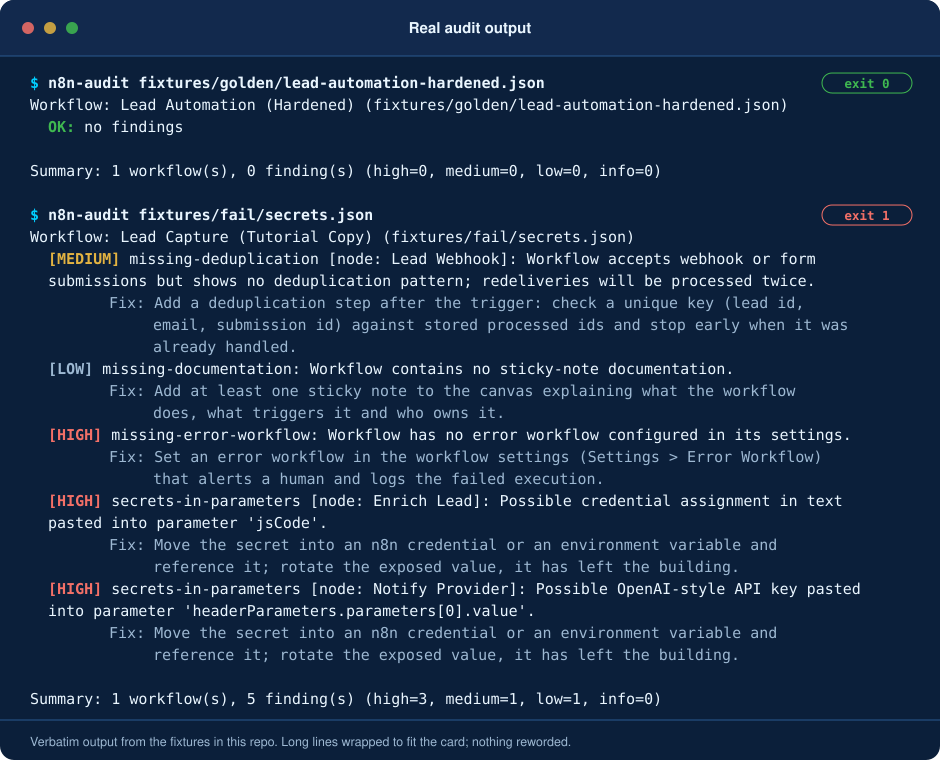
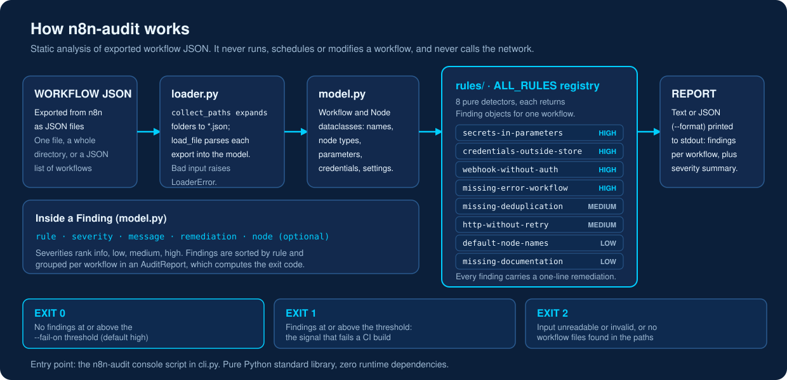
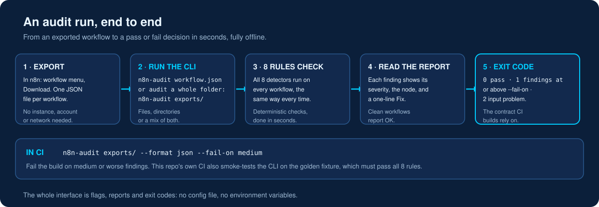
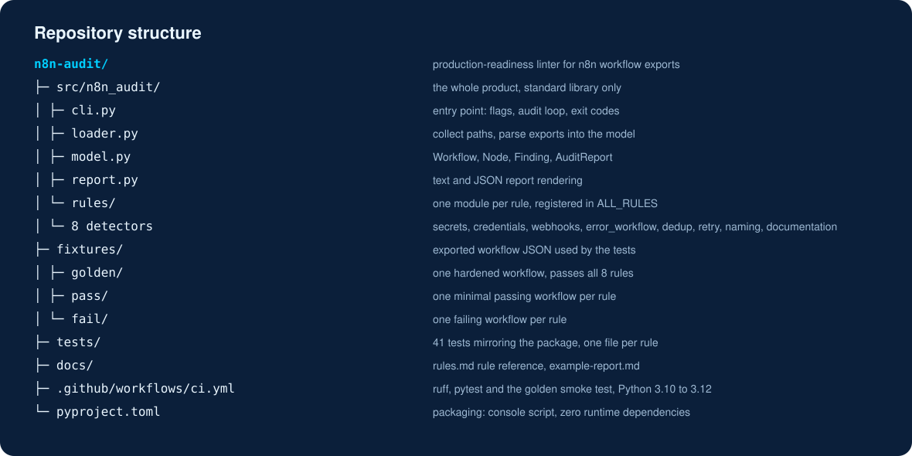

<h1 align="center">n8n-audit</h1>

<p align="center"><strong>n8n-audit is a production-readiness linter for n8n workflows that checks exported workflow JSON for the failure classes that break automations in production, in seconds, locally or in CI.</strong></p>

<p align="center">
  
  <a href="https://github.com/techaurah/n8n-audit/actions/workflows/ci.yml"></a>
  
  
  
  <a href="https://www.linkedin.com/company/techaurah/"></a>
</p>

<p align="center">
  
</p>

**Proof it works:** 41 automated tests, 8 deterministic rules, and a golden fixture that passes all 8 rules, MIT licensed.

<p align="center">
  <a href="docs/rules.md">Rule reference</a> ·
  <a href="docs/example-report.md">Example report</a> ·
  <a href="#examples">Examples (fixtures)</a> ·
  <a href="https://github.com/techaurah/n8n-audit/issues">Roadmap (issues)</a> ·
  <a href="https://github.com/techaurah/n8n-audit/discussions">Discussions</a> ·
  <a href="llms.txt">For AI assistants: llms.txt</a> ·
  <a href="https://techaurah.com">TechAurah</a>
</p>

## What is n8n-audit?

n8n-audit is a free, open-source command-line linter that statically
checks exported n8n workflow JSON for the failure classes that break
automations in production: pasted secrets, unauthenticated webhooks,
missing error workflows, missing deduplication, and HTTP calls without
retry. It runs locally or in CI in seconds, with no n8n instance and
no network access.

It is not an n8n plugin and it does not run, schedule, or modify
workflows: it only reads exported workflow JSON and reports findings,
each with a one-line remediation. n8n-audit is MIT licensed, built by
TechAurah.

<p align="center">
  
</p>

## Why do n8n workflows break in production?

n8n workflows get promoted from tutorial state to production carrying
known, nameable problems: no error workflow, so failures are silent.
Secrets pasted into nodes, so exports leak keys. Webhooks with no
authentication. No deduplication, so a redelivered webhook emails a
lead twice. HTTP nodes with no retry, so one rate-limit response loses
the work forever.

Workflow owners (freelancers, agencies, self-hosting small businesses)
usually discover these when a client workflow silently drops leads.
n8n itself is one of the largest open-source projects in the world
(209,203 stars on GitHub and 13,809 public repositories under the
`n8n` topic, both read via the GitHub API on 2026-10-31), yet nothing
established audits an exported workflow file for these classes before
it ships.

This project does that check. It does not run, schedule or modify
workflows, and it never calls the network: it reads exported JSON and
reports.

## What does a report look like?

A clean workflow reports OK with zero findings and exits 0; a
workflow with problems lists each finding with its severity and a
one-line remediation, and exits 1 at the default threshold. Both
reports below are real output from the fixtures in this repo.

Auditing the hardened example workflow that ships in this repo:

```console
$ n8n-audit fixtures/golden/lead-automation-hardened.json
Workflow: Lead Automation (Hardened) (fixtures/golden/lead-automation-hardened.json)
  OK: no findings

Summary: 1 workflow(s), 0 finding(s) (high=0, medium=0, low=0, info=0)
```

Auditing a workflow with problems (exit code 1, ready for CI):

```console
$ n8n-audit fixtures/fail/
...
Summary: 8 workflow(s), 24 finding(s) (high=6, medium=4, low=14, info=0)
```

A full real report, in text and JSON form, is in
[docs/example-report.md](docs/example-report.md).

## Quickstart

Prerequisites: Python 3.10 or newer. No accounts, no API keys, no
services.

```bash
pip install n8n-audit
```

(From source: `pip install -e .` inside a clone of this repository.)

Export any workflow from n8n (workflow menu, Download) and audit it:

```bash
n8n-audit my-workflow.json
```

Audit every export in a directory, as JSON, failing CI on any medium
or worse finding:

```bash
n8n-audit exports/ --format json --fail-on medium
```

Expected result: a report like the demo above, and an exit code of 0
when nothing at or above the fail threshold is found.

**Ways to run it:**

- **Single file:** `n8n-audit my-workflow.json` audits one exported workflow.
- **Whole directory:** `n8n-audit exports/` audits every export in a folder, with `--format json` for machine-readable reports.
- **In CI:** add `--fail-on medium` (or another severity) so the exit code fails the build on findings at or above that level.

<p align="center">
  
</p>

## What does n8n-audit check?

n8n-audit runs eight deterministic checks on every exported workflow
it reads, covering secrets, credentials, webhook authentication,
error handling, deduplication, retries, node naming, and
documentation. The full rule reference is in
[docs/rules.md](docs/rules.md).

- [x] **`secrets-in-parameters`** (high): keys, tokens, private keys and credential assignments pasted into node parameters. [Rule](docs/rules.md#1-secrets-in-parameters-high)
- [x] **`credentials-outside-store`** (high): credential fields filled directly on a node instead of through n8n credentials. [Rule](docs/rules.md#2-credentials-outside-store-high)
- [x] **`webhook-without-auth`** (high): webhook triggers with no authentication where the export exposes the setting. [Rule](docs/rules.md#3-webhook-without-auth-high)
- [x] **`missing-error-workflow`** (high): no error workflow configured, so failures are silent. [Rule](docs/rules.md#4-missing-error-workflow-high)
- [x] **`missing-deduplication`** (medium): webhook or form trigger with no deduplication pattern. [Rule](docs/rules.md#5-missing-deduplication-medium)
- [x] **`http-without-retry`** (medium): HTTP nodes calling external APIs with no retry and no error handling. [Rule](docs/rules.md#6-http-without-retry-medium)
- [x] **`default-node-names`** (low, report-only): default node names left in production-sized workflows. [Rule](docs/rules.md#7-default-node-names-low-report-only)
- [x] **`missing-documentation`** (low, report-only): no sticky-note documentation on the canvas. [Rule](docs/rules.md#8-missing-documentation-low-report-only)

Every finding includes the workflow, the node when relevant, and a
one-line remediation.

## How is n8n-audit different from checking by hand?

The alternatives today are reviewing exports by hand against a
checklist, relying on the warnings shown while editing in n8n, or not
checking at all. n8n-audit differs by checking the exported file
itself, automatically, the same way every time.

|  | n8n-audit | Manual checklist review | n8n editor warnings | Nothing |
|---|---|---|---|---|
| Cost | Free, open source (MIT) | Free, but reviewer hours per workflow | Free, built into n8n | Free until an incident |
| Runs in CI | Yes: exit codes are designed for CI | No: happens when someone remembers | No: only while editing in the UI | No |
| What it catches | All 8 failure classes, in every export, on every run | Whatever the reviewer happens to spot that day | Some configuration issues at edit time; the exported file as a whole is never audited | Nothing |
| Remediation guidance | A one-line fix with every finding | Depends on the reviewer's experience | Limited to the warning shown | None |
| Effort | Seconds per workflow, single files or whole directories | Minutes to hours per workflow | Only while you happen to be editing | Zero, until a workflow silently drops leads |

## How do you configure n8n-audit?

n8n-audit has no config file and reads no environment variables. All
behaviour is set by command line flags:

| Flag | Values | Default | Purpose |
|---|---|---|---|
| `--format` | `text`, `json` | `text` | Report format |
| `--fail-on` | `high`, `medium`, `low`, `info` | `high` | Lowest severity that produces exit code 1 |
| `--version` | | | Print the version |

Exit codes: `0` means no findings at or above the threshold, `1` means
findings at or above it, `2` means the input could not be read or
parsed. Inputs may be single files, several files, directories (all
`*.json` inside are audited), or a mix. A file holding a JSON list of
workflows is supported, matching multi-workflow exports.

## Examples

Everything below runs offline on included fixture data. No credentials
are needed for any of them.

| Example | What it shows | Time |
|---|---|---|
| `fixtures/golden/lead-automation-hardened.json` | A production lead-automation workflow that passes all 8 rules: authenticated webhook, deduplication, error workflow, retries, credentials store, sticky-note docs | 10 seconds |
| `fixtures/pass/*.json` | One minimal passing workflow per rule | 10 seconds each |
| `fixtures/fail/*.json` | One failing workflow per rule: run `n8n-audit fixtures/fail/` and read the report against [the rule reference](docs/rules.md) | 1 minute |

## Roadmap

- **Now:** v0.1, the 8 rules above, text and JSON reports, CI exit codes.
- **Next:** more node-type coverage (queues, databases, AI agent nodes),
  SARIF output for GitHub code scanning, per-rule ignore comments.
- **Later:** an n8n community node or editor integration, if the CLI
  proves the rules are useful. Roadmap items are tracked as issues.

## Frequently asked questions

### What does n8n-audit cost?

n8n-audit is free and open source under the MIT license. There is no
paid tier, no account, and no usage limit. The only cost is running
it: it is a small Python command-line tool with no runtime
dependencies, so it runs on any machine or CI runner you already have.

### Does n8n-audit run my workflows or need my n8n instance?

No. n8n-audit never connects to an n8n instance and never executes,
schedules, or modifies a workflow. You export a workflow from n8n as
JSON (workflow menu, Download) and point the tool at the file or a
directory of exports. It reads the JSON statically and prints a
report.

### What does n8n-audit check?

It checks eight deterministic rules: secrets pasted into node
parameters, credential fields filled outside the n8n credentials
store, webhooks without authentication, workflows with no error
workflow, missing deduplication near webhook or form triggers, HTTP
nodes without retry or error handling, default node names, and
missing sticky-note documentation.

### Can n8n-audit run in CI?

Yes. CI is a primary use case. The exit codes are the contract: 0
when nothing is found at or above the severity threshold, 1 when
findings meet it, 2 when input cannot be read. Set the threshold with
--fail-on, emit JSON with --format json, and fail the build on
high-severity findings by default.

### What does n8n-audit not do?

n8n-audit does not run workflows, connect to n8n, call any network
service, or change your files. It does not judge workflow logic,
business correctness, or performance, and its deduplication check is
a documented keyword heuristic, so an unusually named deduplication
step can be missed. It audits structure and configuration only.

### How do I add a rule?

A rule is one detector function plus fixtures and tests. Add the
function in src/n8n_audit/rules/, register it, add a passing fixture
and a failing fixture under fixtures/, write tests, and document it
in docs/rules.md with a CHANGELOG entry. CONTRIBUTING.md has the full
checklist, and new rules are the recommended first contribution.

### Where do I get help or report a problem?

Use GitHub Issues for bugs and for feature or rule requests, with
the templates provided. Use GitHub Discussions for questions, ideas,
and show and tell. Report security vulnerabilities privately by
following SECURITY.md, never in a public issue. The Community and
support table in this README routes each case to the right channel.

### Can I use n8n-audit for client work?

Yes. The MIT license permits commercial use, including auditing
client workflows as part of paid delivery work, with no license fee
and no per-seat cost. TechAurah itself uses these checks in client
workflow audits. Keep the license notice with any copies you
distribute, as the MIT terms require.

Questions and ideas: use [GitHub Discussions](https://github.com/techaurah/n8n-audit/discussions).

## Repository structure

<p align="center">
  
</p>

The full annotated tree is in [docs/assets/directory-tree.txt](docs/assets/directory-tree.txt).

## Contributing

Read [CONTRIBUTING.md](CONTRIBUTING.md), find a
`good first issue`, and open a pull request that links the issue and
passes CI. The best first contribution is a new rule: one detector
function, one passing fixture, one failing fixture, tests. See
CONTRIBUTING for the full checklist.

## Community and support

| Channel | Best for |
|---|---|
| [GitHub Issues](https://github.com/techaurah/n8n-audit/issues) | Bugs and feature or rule requests (use the templates) |
| [GitHub Discussions](https://github.com/techaurah/n8n-audit/discussions) | Questions, ideas, show and tell |
| [SECURITY.md](SECURITY.md) | Vulnerabilities: report privately, never in a public issue |

## License

MIT. See [LICENSE](LICENSE).

## About TechAurah

TechAurah is an AI and software engineering company building AI
products, agents and intelligent automation for businesses in the USA,
UK, UAE, Canada, Australia and Europe. This tool grew out of real
client workflow audits: the rules are the checks we run by hand before
any workflow touches a client's leads.

We are available for AI engineering projects: https://techaurah.com

## More from TechAurah

- [ai-lead-automation](https://github.com/techaurah/ai-lead-automation): our open blueprint for automating lead handling in service businesses: capture, instant reply, AI qualification, CRM write, follow-up, and booking.
- [leadpipe-mcp](https://github.com/techaurah/leadpipe-mcp): an MCP server that gives small businesses without a CRM a scored, bookable lead pipeline on Google Sheets and Calendar.
- [qualbench](https://github.com/techaurah/qualbench): outcome regression testing for AI qualification and booking agents, with mock CRM and calendar and vertical scenario packs.
- [chasekit](https://github.com/techaurah/chasekit): the open-source invoice-chasing layer: overdue detection, statutory late-payment interest for the UK and EU, and a four-stage tone ladder.
- [slotfill](https://github.com/techaurah/slotfill): no-show recovery for appointment businesses: reminders and waitlist backfill on the calendar you already use.

All of TechAura's open-source projects are MIT licensed and open to contributions: [github.com/techaurah](https://github.com/techaurah)

Follow TechAurah on [LinkedIn](https://www.linkedin.com/company/techaurah/).
